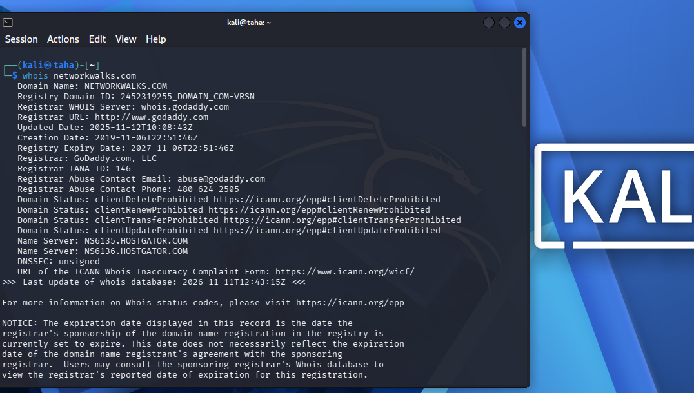
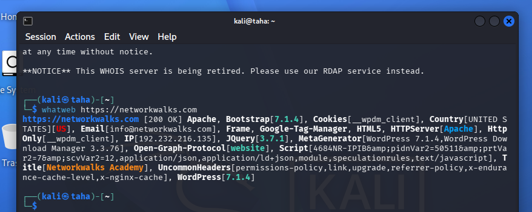
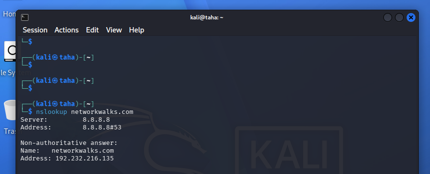
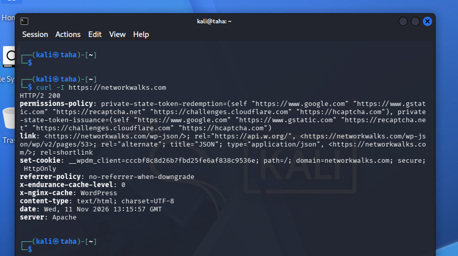
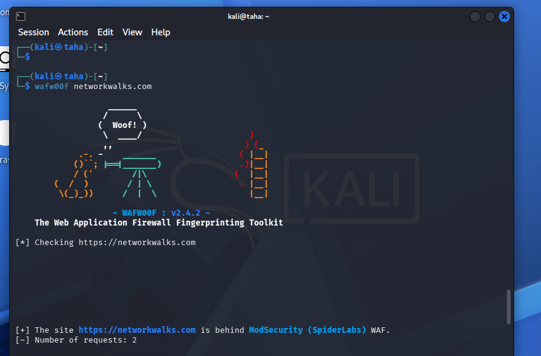
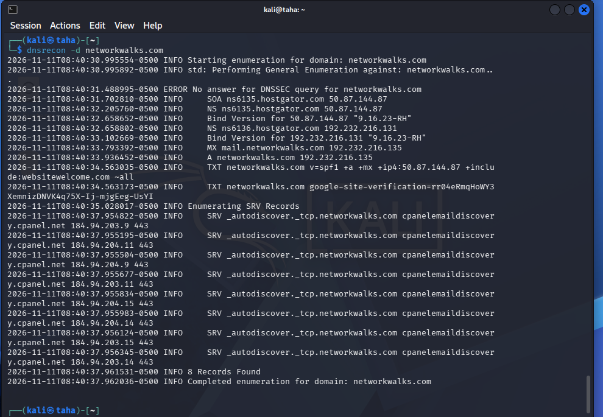

# W2-PM1 — Footprinting & Reconnaissance with Kali Linux

**Status:** Completed — 6/6 tasks  
**Target:** `networkwalks.com`  
**Environment:** Kali Linux (VirtualBox)  
**Objective:** Collect publicly available information about a website's domain, DNS infrastructure, HTTP response, web technologies, and security controls.

## Task summary

| # | Tool | Command | Key result |
|---|---|---|---|
| 1 | WHOIS | `whois networkwalks.com` | GoDaddy registrar; HostGator nameservers |
| 2 | WhatWeb | `whatweb https://networkwalks.com` | Apache, WordPress, jQuery |
| 3 | NSLookup | `nslookup networkwalks.com` | Domain resolved successfully |
| 4 | cURL | `curl -I https://networkwalks.com` | HTTP/2 200; headers and cookies |
| 5 | WAFW00F | `wafw00f networkwalks.com` | ModSecurity (SpiderLabs) fingerprint |
| 6 | DNSRecon | `dnsrecon -d networkwalks.com` | DNS, mail and TXT records |

## Task 1 — WHOIS

**Purpose:** Inspect public domain registration information.

```bash
whois networkwalks.com
```

**Observed:** Domain created in November 2019; GoDaddy registrar; expiry in November 2027; `ns6135.hostgator.com` and `ns6136.hostgator.com` appeared in registry output; registrant details protected by a privacy service; DNSSEC unsigned. The registrar's WHOIS response also listed additional nameservers, so the two sections were not identical.

**Learning:** WHOIS helps identify registration and DNS administration, but does not prove the web server's physical location or owner.



## Task 2 — WhatWeb

**Purpose:** Fingerprint the public website technology stack.

```bash
whatweb https://networkwalks.com
```

**Observed:** `200 OK`, Apache, WordPress `7.1.4` (reported), WordPress Download Manager `3.3.76`, jQuery `3.7.1`, Google Tag Manager, `HttpOnly` cookie, website title **Networkwalks Academy**, and IPv4 address `192.232.216.X` (masked).

**Learning:** Technology fingerprints are clues, not proof of a vulnerability. WhatWeb sends HTTP requests to the target, so this is **active reconnaissance**.



## Task 3 — NSLookup

**Purpose:** Resolve a domain through DNS.

```bash
nslookup networkwalks.com
```

**Observed:** Google Public DNS (`8.8.8.8`) returned a non-authoritative answer with IPv4 address `192.232.216.X` (masked), consistent with WhatWeb.

**Learning:** A non-authoritative response is supplied by a resolver, rather than directly by an authoritative nameserver.



## Task 4 — cURL

**Purpose:** Inspect HTTP response headers without downloading the page body.

```bash
curl -I https://networkwalks.com
```

**Observed:** `HTTP/2 200`, `server: Apache`, HTML UTF-8, WordPress REST API links, `Secure` and `HttpOnly` cookie attributes, `permissions-policy`, and `referrer-policy`.

**Learning:** Response headers reveal server configuration and browser protections. A missing header in one captured response is a **review item**, not a confirmed security flaw. This is active HTTP reconnaissance.



## Task 5 — WAFW00F

**Purpose:** Check whether the website exhibits a recognizable WAF fingerprint.

```bash
wafw00f networkwalks.com
```

**Observed:** WAFW00F `2.4.2` reported **ModSecurity (SpiderLabs)**, using two requests.

**Learning:** A WAF fingerprint does not prove the exact rule set or effectiveness of the protection. This tool actively queries the target.



## Task 6 — DNSRecon

**Purpose:** Enumerate DNS resource records.

```bash
dnsrecon -d networkwalks.com
```

**Observed:**

- A record: `192.232.216.X` (masked)
- NS: `ns6135.hostgator.com`, `ns6136.hostgator.com`
- MX: `mail.networkwalks.com` (address masked)
- DNS software fingerprint: BIND `9.16.23-RH`
- TXT: SPF policy and Google site-verification token (token intentionally omitted)
- SRV: eight autodiscovery responses pointing to cPanel email discovery infrastructure

**Tool message:** `ERROR No answer for DNSSEC query for networkwalks.com`. The scan nevertheless completed normally.

**Learning:** DNS enumeration can reveal externally published infrastructure and email services. DNSRecon's behavior and active/passive classification depend on the query type and options.




