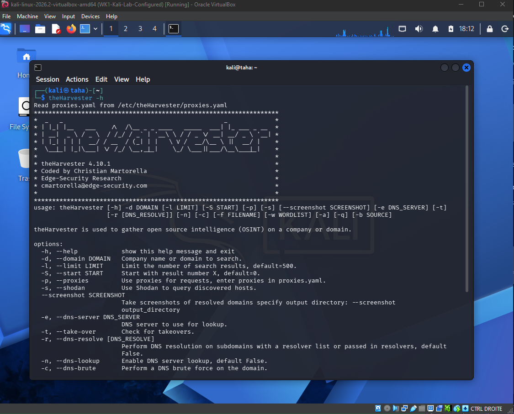
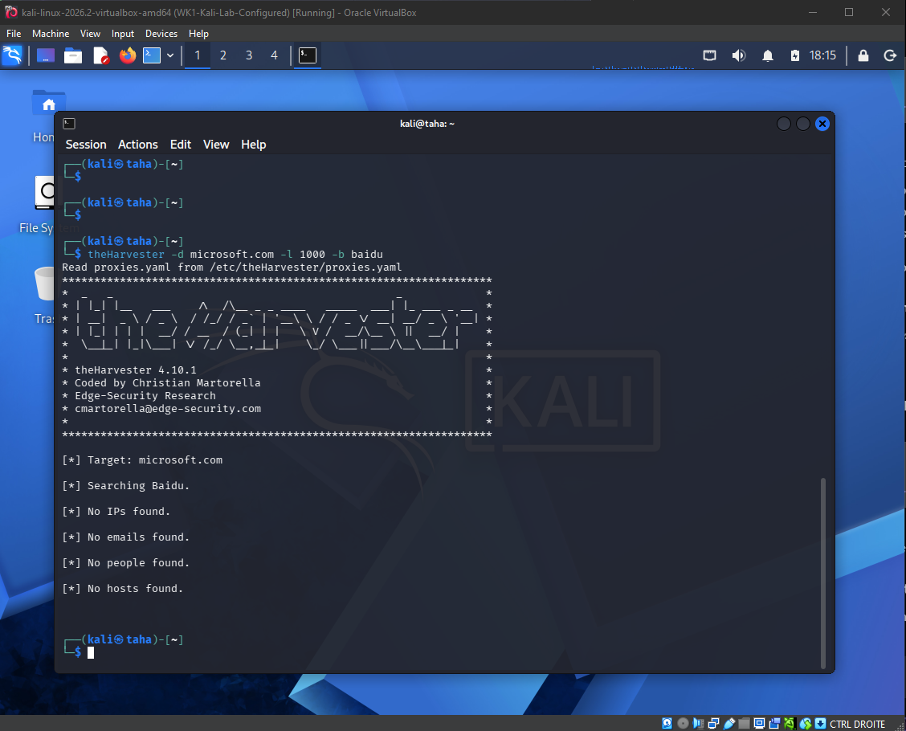
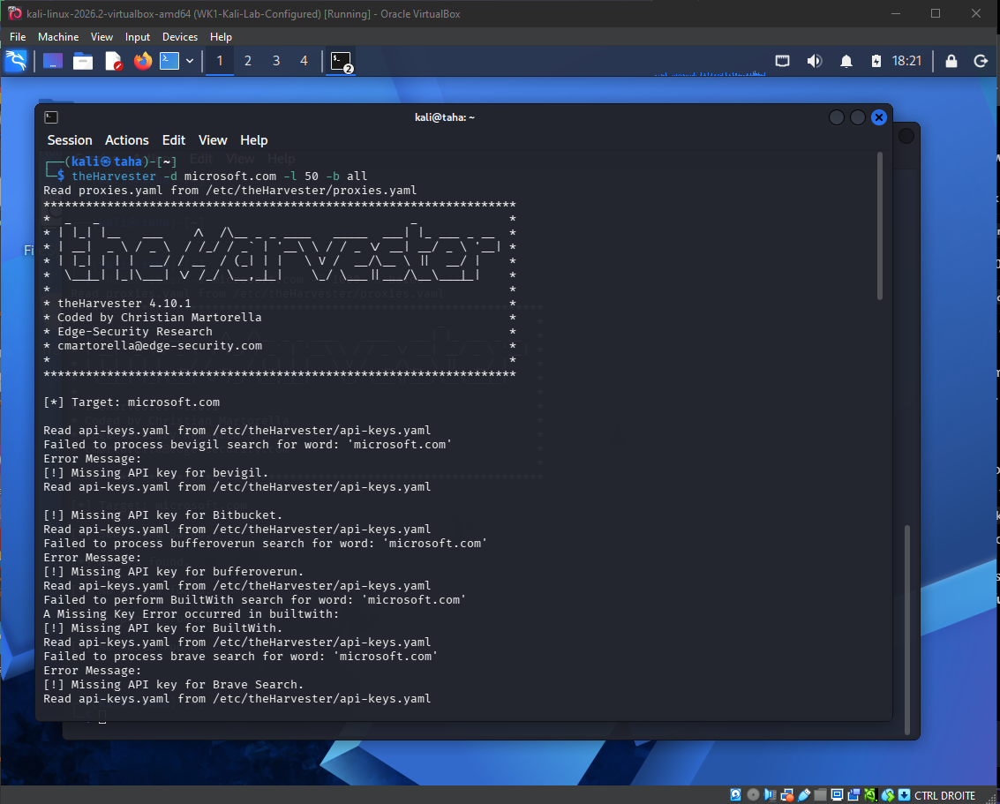
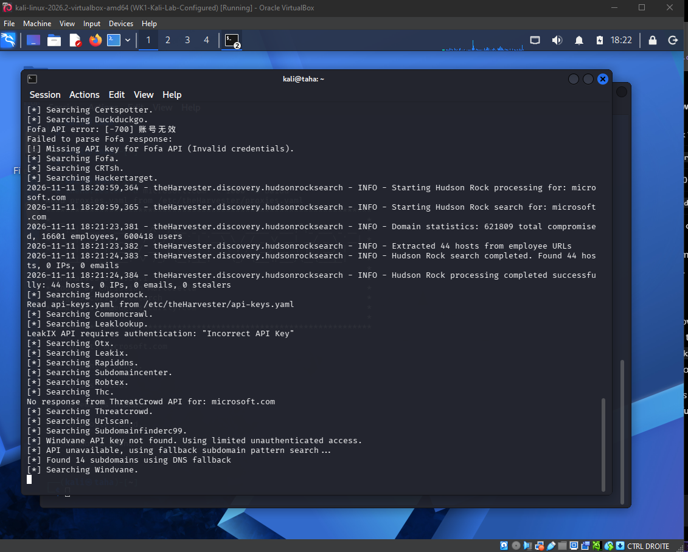
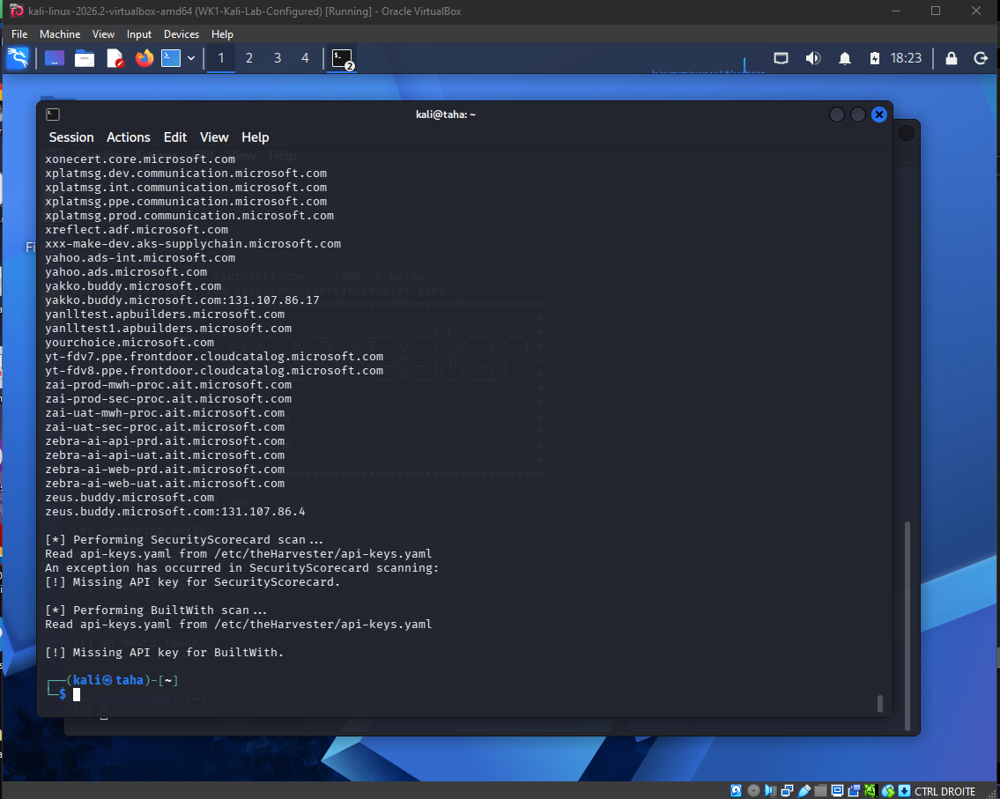

# W2-PM4 — OSINT Reconnaissance Using theHarvester

**Intern:** Taha Chebil  
**Batch:** B084  
**Program:** NetworkWalks — Cybersecurity & Ethical Hacking Internship  
**Week:** 2  
**Environment:** Kali Linux 2026.2 in Oracle VirtualBox  
**Tool:** theHarvester 4.10.1  
**Status:** Completed — 2/2 tasks

## 1. Objective

Learn how to use **theHarvester** to collect publicly available information about a domain using open-source intelligence (OSINT). Compare the results of searching a single source with those from multiple sources, and recognize the effect of API restrictions on data collection.

**Training domain:** `microsoft.com`  
**Scope:** OSINT discovery and review only. No exploitation, authentication attempts, or vulnerability claims.

## 2. Task summary

| Task | Command | Outcome | Status |
|---|---|---|---|
| 1 — Search with Baidu | `theHarvester -d microsoft.com -l 1000 -b baidu` | No IPs, emails, people, or hosts returned | ✅ Completed |
| 2 — Search with all sources | `theHarvester -d microsoft.com -l 50 -b all` | Multiple subdomains discovered; some sources produced API warnings | ✅ Completed |

> A successful OSINT task does not require finding results from every source. Zero results are still a valid observation when the command finishes correctly.

## 3. Task 1 — Baidu reconnaissance

### Purpose

Test whether a single search engine can provide publicly indexed domain information.

### Command

```bash
theHarvester -d microsoft.com -l 1000 -b baidu
```

### Observations

- The command executed and returned to the terminal prompt.
- Output reported **no IPs, emails, people, or hosts found**.
- This is a valid result for the selected source, not evidence that the domain has no subdomains.

### Evidence

**Figure 1 — Tool installation and available options**



**Figure 2 — Baidu-only search result**



## 4. Task 2 — Multi-source reconnaissance

### Purpose

Compare a multi-source OSINT search with the single-source search and identify how different providers contribute findings.

### Command

```bash
theHarvester -d microsoft.com -l 50 -b all
```

### Observations

- The tool queried several available OSINT providers.
- **Hudson Rock reported 44 hosts** in its processing output.
- A DNS fallback mechanism reported **14 subdomains**.
- The full output included many domain-related hostnames and some IP address mappings.
- Some providers could not complete their searches because their API keys were missing, invalid, or unavailable.
- The process completed and returned to the shell prompt.

**Important:** Counts from different providers may overlap. Do not add them together as a verified unique-host total. A discovered hostname is not proof of a reachable or vulnerable system.

### Evidence

**Figure 3 — Multi-source scan and API-key warnings**



**Figure 4 — Provider discovery and fallback results**



**Figure 5 — End of theHarvester execution**



## 5. Issues encountered and lessons learned

| Issue / observation | Explanation | Lesson |
|---|---|---|
| Baidu returned zero findings | Search-engine coverage can vary | One source is not sufficient to characterize a domain |
| Missing API keys | Some providers require accounts and credentials | Not every `-b all` source is usable without configuration |
| Invalid credentials / provider errors | Individual integrations can fail | A provider failure does not necessarily stop the entire search |
| Numerous subdomains in combined output | Different sources may discover overlapping assets | Validate and deduplicate findings before making conclusions |

## 6. Key concepts practiced

- **OSINT:** Collecting and analyzing information available from public sources.
- **Domain reconnaissance:** Identifying public references to domain-related infrastructure.
- **Subdomain discovery:** Finding hostnames associated with a domain.
- **Search-source comparison:** Comparing a single provider with several providers.
- **API authentication:** Understanding why some data sources require credentials.
- **Evidence collection:** Recording commands, results, limitations, and screenshots.

## 7. Conclusion

Both W2-PM4 tasks were completed. The Baidu-only search returned no findings, whereas the multi-source search produced numerous domain-related results. This exercise demonstrated the value of comparing OSINT sources and documenting limitations such as missing API keys. No discovered host was treated as a confirmed vulnerability.

## 8. Ethical use and publication safety

This exercise was limited to information gathering for educational purposes. Do not perform active scans or testing against third-party systems without authorization.

**Before making this repository public:** Review all screenshots and logs. The multi-source output may contain internal-looking or non-public infrastructure names. Redact such details from image pixels, not just from Markdown text. Do not upload API keys, credentials, private data, or unfiltered bulk reconnaissance output.

## References

- [theHarvester — GitHub](https://github.com/laramies/theHarvester)
- [Kali Linux](https://www.kali.org/)
- [NetworkWalks](https://networkwalks.com/)

---

*Prepared by Taha Chebil — NetworkWalks Internship, Batch B084 — November 2026.*
