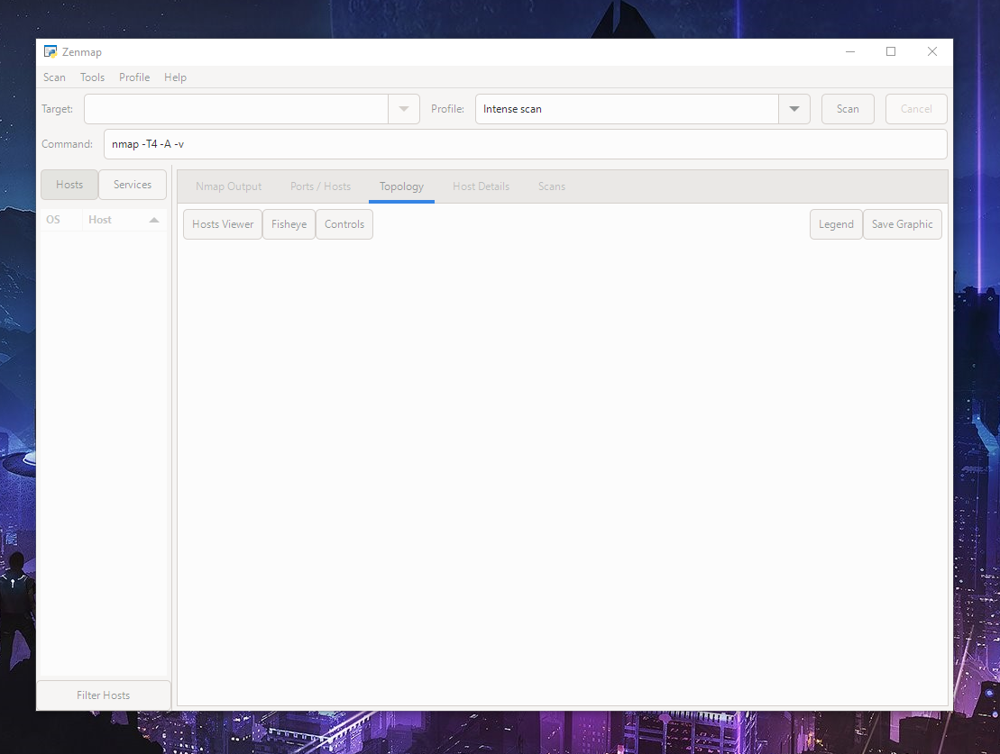
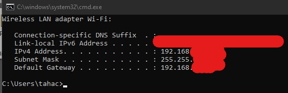
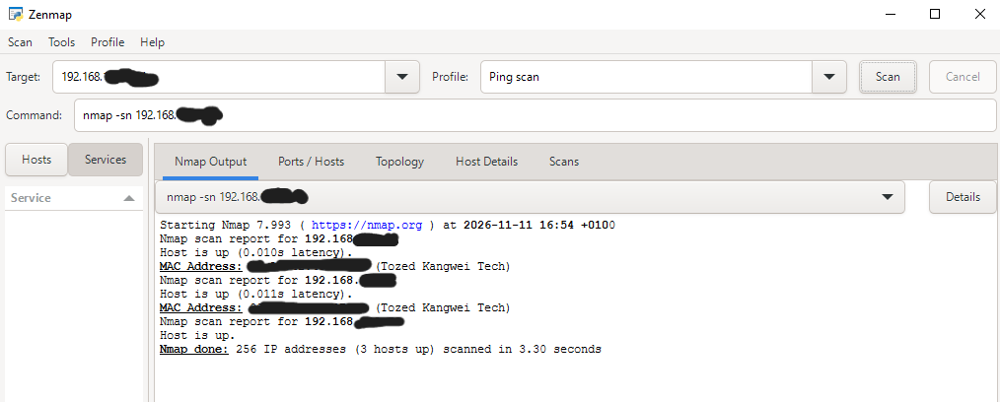
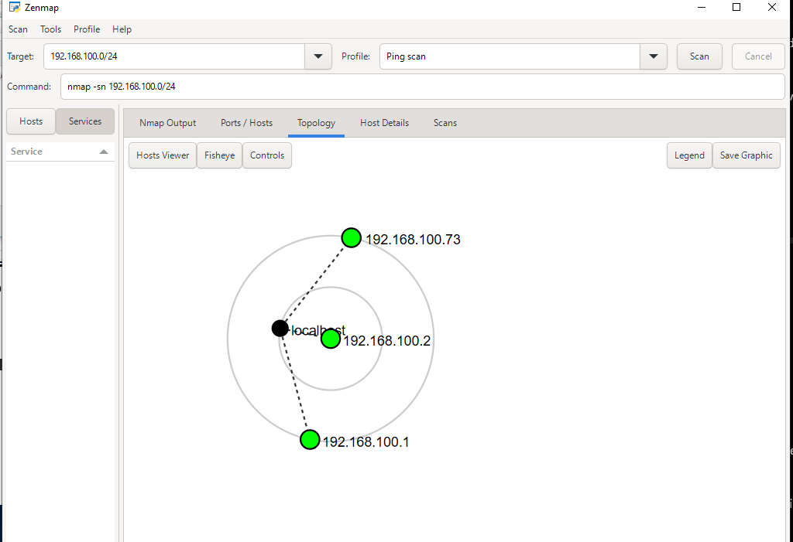

# W2-PM5 — Network Scanning with Zenmap

**Status:** Completed — 7/7 tasks  
**Environment:** Windows 10, Zenmap / Nmap `7.993`  
**Scan type:** Ping Scan (host discovery only)  
**Scope:** Authorized local Wi-Fi `/24` subnet; IPs partially masked in this public report.

## Objective

Identify the local network configuration, discover responding hosts, document IP and MAC address information, and visualize/export the network topology.

## Tasks and results

| Task | Activity | Result |
|---|---|---|
| 1 | Install and launch Zenmap | Completed |
| 2 | Identify local network using `ipconfig` | Wi-Fi subnet `192.168.X.X/24` (masked) |
| 3 | Run Zenmap Ping Scan | Completed |
| 4 | Count responding hosts | **3 hosts up** |
| 5 | Identify responding IPs | 3 local IPv4 addresses (masked) |
| 6 | Identify MAC addresses | 2 in Zenmap + local adapter using `ipconfig /all` |
| 7 | Visualize/export topology | Zenmap topology exported as PDF |

### Task 1 — Install Zenmap

Installed Zenmap on Windows and opened the application successfully.



### Task 2 — Identify the network

```cmd
ipconfig
```

**Observed:** Wi-Fi IPv4 address `192.168.X.X`, subnet mask `255.255.255.0`, gateway `192.168.X.X`. The actual network prefix was `/24`.



### Tasks 3–5 — Discover and count live hosts

**Actual scan profile:** Zenmap **Ping scan**. The following command is **redacted for publication** and is not meant to be copied as a runnable command:

```text
nmap -sn 192.168.X.X/24
```

`-sn` performs host discovery without a port scan.

**Observed scan output:**

- **256 IP addresses** examined
- **3 hosts up**
- **3.30 seconds** scan duration
- Three responding devices represented as Host 1, Host 2, and Host 3

| Host | Partially masked IP | Interpretation |
|---|---|---|
| Host 1 | `192.168.X.X` | Default gateway, likely router |
| Host 2 | `192.168.X.X` | Another responding device; exact identity unverified |
| Host 3 | `192.168.X.X` | Local Windows PC |

> Not every connected device necessarily responds to host-discovery probes. The scan results are not a complete asset inventory.



### Task 6 — MAC address information

The scan showed MAC addresses for two neighboring devices. The local PC's Wi-Fi adapter MAC was checked using:

```cmd
ipconfig /all
```

| Host | Partially masked MAC |
|---|---|
| Host 1 | `98:X:X:XX:XX:XX` |
| Host 2 | `98:X:X:XX:XX:XX` |
| Host 3 (local PC) | `04:X:X:XX:XX:XX` |

**Learning:** The first three MAC bytes may identify an organizational vendor prefix, but the prefix does not prove the exact device model. The remaining bytes are hidden for privacy.

### Task 7 — Network topology

Opened Zenmap's **Topology** tab, reviewed the three responding hosts, and exported the graphical view as a PDF.



**Learning:** Zenmap's visualization summarizes scan observations; it is not necessarily a physical wiring diagram.
